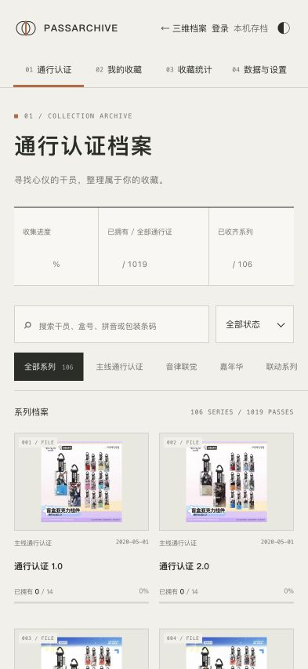

# Arknights PassArchive · 通行认证档案

《明日方舟》《明日方舟：终末地》实体通行认证的查询、收藏与购买记录工具。Web 使用 RhineLabUI 三维终端与二维目录，Django 提供共享 API 和 PostgreSQL 账号存档，iOS 提供原生 SwiftUI 起点。

[在线使用](https://arknights.yukkuri.win/) · [下载 Release](https://github.com/iseeyoudream07/Arknights-PassArchive/releases/latest) · [部署文档](docs/deployment-guide.md) · [API](docs/api.md) · [第三方授权](THIRD_PARTY_NOTICES.md)

## 功能与进度

| 部分 | 当前范围 |
| --- | --- |
| 目录 | 106 个系列、1,019 种通行认证、455 名干员；名称、中英文、拼音、盒号、条码和星级检索 |
| 收藏 | 拥有状态、市场参考价、多笔购买记录、数量、收集进度与估算盈亏 |
| 账号 | 注册、登录、修改密码、退出；PostgreSQL 保存各账号的收藏与关注系列 |
| 同步 | IndexedDB 先保存；联网后合并；不同条目自动合并，同一条冲突由用户选择；访客与账号独立 |
| 备份 | JSON 导入导出、兼容原收集册格式、保留未匹配条目和导入前恢复点 |
| Web | 开屏、三维档案阵列、抽取解密、模型查看器、二维管理、深浅主题、移动端与离线缓存 |
| iOS | SwiftUI 目录、搜索、系列详情、拥有状态与 SwiftData 本机保存；价格编辑、备份、账号与同步尚未接入 |

精一、精二分别记录；价格由用户填写。账号当前使用用户名和密码，没有邮箱找回流程。离线访问需要事先加载过相应页面与资源。



## 本地运行

需要 Python 3.12+、Node.js 22.12+、Git。克隆后进入仓库根目录：

```bash
git clone https://github.com/iseeyoudream07/Arknights-PassArchive.git
cd Arknights-PassArchive
python3 -m venv .venv
.venv/bin/python -m pip install -r backend/requirements.txt
.venv/bin/python backend/manage.py migrate
.venv/bin/python backend/manage.py runserver 127.0.0.1:8000
```

另开终端，在仓库根目录运行：

```bash
cd web
npm ci --ignore-scripts
npm run dev
```

打开 <http://127.0.0.1:5173/>。开发环境使用 SQLite，Web 将 `/api/` 转发到本机 Django；正式环境强制使用 PostgreSQL。随仓库提供统一目录和运行所需静态资源，无需重新获取原始上传文件。

## 构建与 Release

```bash
cd web
npm run build
npm test
```

生产静态文件位于 `web/dist/`。`npm run preview` 仅预览静态页面，不转发账号 API；访客功能可本机使用，账号同步需同源 Django。正式部署使用独立 Web、API 和 PostgreSQL 容器，HTTPS 入口代理到仅监听本机的容器端口；前端可从源码构建，也可封装已验证的静态包。完整步骤见 [部署文档](docs/deployment-guide.md)。

Release 提供：

- `PassArchive-source-v版本.zip`：与对应 Git 提交一致的完整公开源码，含 Django、Web、SwiftUI 工程及必要资源。
- `PassArchive-web-v版本.zip`：已构建静态站点，可直接解压到 Web 根目录；账号功能需另外部署 Django 与 PostgreSQL。
- `SHA256SUMS.txt`：两个发布包的 SHA-256 校验清单。

```bash
shasum -a 256 -c SHA256SUMS.txt
```

维护者可在干净的 Git 检出中生成同样结构的发布包：

```bash
python3 tools/build_release.py
```

输出在 `artifacts/releases/v版本/`。发布工具只打包 Git 跟踪的源码和本次构建的静态文件，不打包数据库、密钥、原始上传、部署现场记录或本机依赖。

## iOS 原生起点

使用 Xcode 打开 `ios/PassArchive.xcodeproj`，选择 PassArchive 和 iPhone 模拟器运行。最低 iOS 17，无第三方 Swift 包。真机安装需选择自己的开发团队；本 Release 不含签名 IPA。

`ios/PassArchive/ArchiveStore.swift` 配置目录 API 地址。首次离线目录随 App 提供，图片在线获取。iOS 收藏当前独立保存在 SwiftData，不会自动同步 Web。

```bash
xcodebuild -project ios/PassArchive.xcodeproj -scheme PassArchive \
  -destination 'generic/platform=iOS Simulator' \
  -derivedDataPath ios/build CODE_SIGNING_ALLOWED=NO build
```

## 检查

```bash
node tools/upstream_oracle.mjs
.venv/bin/python backend/manage.py test api
cd web
npm run build
npm test
```

前端检查覆盖统计规则、备份转换、账号隔离与合并、列表节点复用、连续保存、三维生命周期及缓存边界。后端在 SQLite 下跳过真实 PostgreSQL 并发测试；仓库 CI 使用独立 PostgreSQL 17 执行完整后端检查。任何测试都不要指向正在提供用户服务的数据库。

## 项目结构

```text
backend/      Django API、会话认证、PostgreSQL 存档和统计规则
web/          三维终端、二维收藏管理、IndexedDB 与离线缓存
ios/          SwiftUI 工程与 SwiftData 本机存档
data/         标准化目录和旧版映射
shared/       上游统计验证样例
tools/        数据构建、验证、工程生成和 Release 打包
deploy/       公开部署模板；密钥不随仓库提供
docs/         API、账号、部署、数据来源和动效说明
upstream/     主体目录参考快照及原版权说明
references/   RhineLabUI 固定源文件的校验清单
licenses/     第三方许可全文
```

## 数据与来源

- 主体目录与规则：[SpectMercyRE/Arknights-pass-statistics](https://github.com/SpectMercyRE/Arknights-pass-statistics)，固定提交 `1f31daf9edc7c0afb3ddc6744cd5809ca911957f`。
- 盒号、条码及日期补充：[ArknightsAuthorization_Series-mirror](https://github.com/awadwd/ArknightsAuthorization_Series-mirror)，来源为上传的静态资料库。未导入预测盒和资料库市场价。
- 终端、动效与原创模型：[LBEILC/RhineLabUI](https://github.com/LBEILC/RhineLabUI)，固定提交 `12cc5e4013acb9408f753ff71de6b8492299b7c8`；制作流程参考 [RhineLabUI-Workflow](https://github.com/LBEILC/RhineLabUI-Workflow)。
- 游戏美术与标志、MiSans 字体、文字图形和声音分别保留原声明，详见 [第三方声明](THIRD_PARTY_NOTICES.md)。

保留来源冲突与未知元数据，不猜测缺失值。[数据审计](docs/data-audit.json) 记录映射、差异、来源和校验。日常运行不依赖原始压缩包；需要重建目录时，另行准备具有使用权的原始资料，按 `tools/build_catalog.py --help` 指定只读来源目录。

## License

本项目新增原创代码采用 [MIT](LICENSE)。第三方代码按各自 MIT 声明使用；补充数据适用 [CC BY-NC 4.0](licenses/CC-BY-NC-4.0.txt)，字体和游戏素材不因代码开源而重新授权。包含这些数据与素材的整包作为非官方、非商业学习交流项目提供。

本项目与游戏官方无隶属关系，不代表官方认可。完整版权范围、修改说明和来源见 [THIRD_PARTY_NOTICES.md](THIRD_PARTY_NOTICES.md)。
