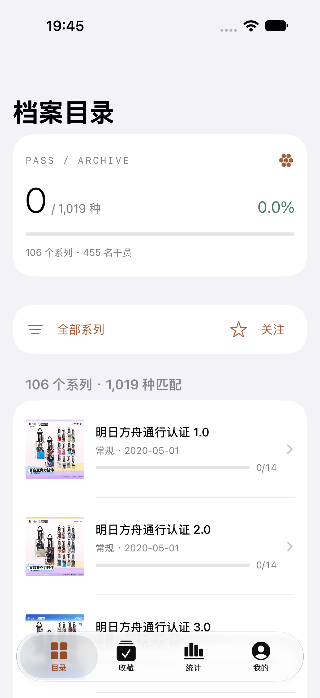
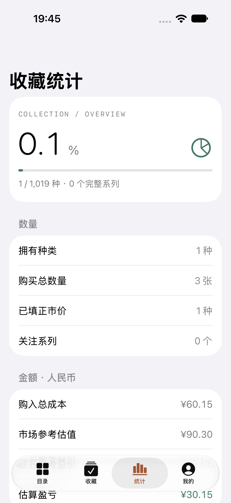

# iOS 首版验收记录

这是首版记录；后续中文文案与安全修复见 [2026-10-16 复查记录](ux-security-review-20261016.md)。

验收日期：2026-10-15。环境：Xcode 27.0（27A266a），iPhone 18 Pro / iOS 27.0 独立模拟器。

| 检查 | 结果 |
|---|---|
| 通用 iOS Simulator 最终构建 | 通过，无需签名 |
| Swift 规则、本机存档和同步 | 23 项通过；需要 HTTP 的 1 项在接口流程中单独通过 |
| 上游统计规则 | 全部 24 组共享样例一致，包括精确金额和特殊盒计价 |
| 真实旧数据库升级 | 缺少 stateData 列的旧数据库升级后拥有状态保留 |
| 原生 HTTP 客户端 | 注册、登录、CSRF、幂等保存、409 版本冲突、账号隔离、修改密码和退出通过 |
| Swift / Web / Django 互通 | iOS 导出的收藏、关注、待匹配数据与统计一致 |
| iPhone 原生 UI | 3 项通过：价格数量与统计、拼音搜索与关注、登录并上传云端 |
| Web 回归 | 30 项通过 |
| 项目完整性 | Swift 源码均已登记，随包目录与统一目录一致，共享 scheme、CI YAML 与 Python 脚本检查通过 |

接口验收使用临时 SQLite 和临时账号，仅监听本机；测试库退出后移除，未访问生产用户数据。详细日志、原生源码 SHA-256 和 xcresult 路径保存在本机 `artifacts/ios-final-verification.json`。

iOS 17、iPad、真机签名安装、后台挂起后的系统调度与生产站点账号联调未在本轮验证。三维终端通过 Web 入口访问，原生三维渲染和相机扫码不属于本次首版。CI 已加入 iOS 检查任务，远端 CI 尚未运行。

## 实际模拟器截图

 

构建、备份迁移和联调说明见 [iOS 开发说明](ios.md)。
