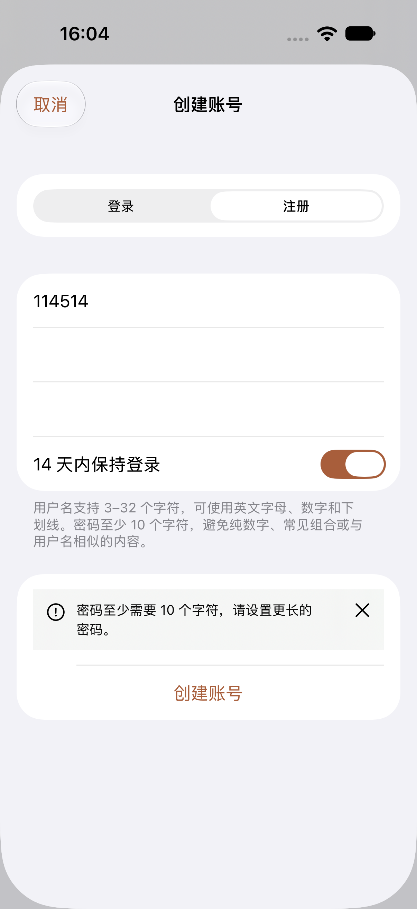
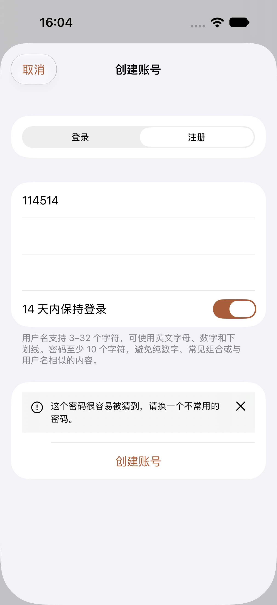
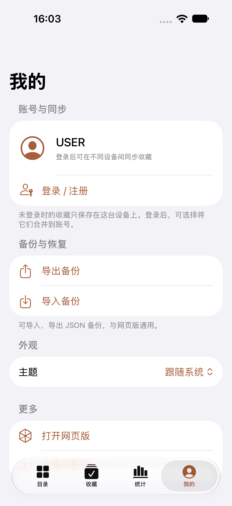
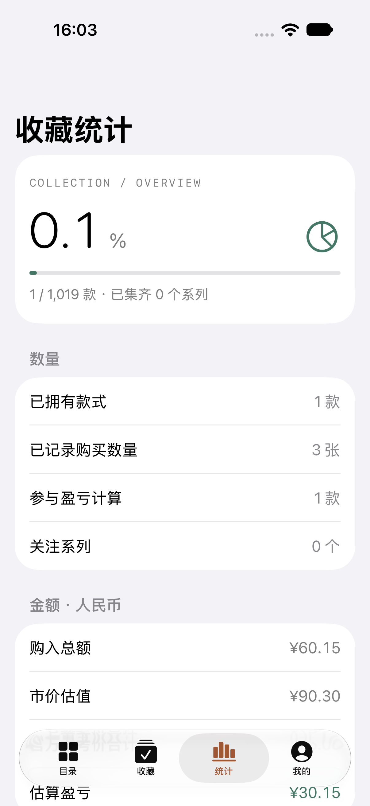

# 中文文案与安全复查

日期：2026-10-16。范围：iOS 原生应用、网页版目录与账号页面、三维页面设置文案、共享账号与备份接口，以及项目依赖。修改位于本地源码，未部署到线上服务。

## 文案调整

注册和修改密码不再直接拼接 Django 校验器的原始报错。服务器按稳定的错误码返回一条优先处理的中文建议，同时保留完整规则列表；客户端也能处理旧服务器返回的中英混合提示。长度、纯数字和确认密码等常见问题先在本地检查，服务器继续执行完整密码强度校验。

| 原来的表述 | 现在的表述或处理 |
|---|---|
| 密码跟 用户名 太相似了 + 英文长度提示 + 纯数字提示 | 一次显示一条明确建议，例如“密码至少需要 10 个字符，请设置更长的密码。” |
| 保持登录 14 天 | 14 天内保持登录 |
| 同 ID 替换 | 将替换的现有记录 |
| 待匹配条目 | 未识别的记录，并说明仍可同步和导出 |
| 已填正市价 | 参与盈亏计算，并解释市价为空或为 0 的统计规则 |
| 请退出后重新编辑 | 请返回后重新打开再编辑，避免误以为需要退出账号 |
| 编目范围（实际显示日期） | 发行日期 |
| 收束、硬件限制时自动收敛等实现描述 | 结束动画、超过设备支持范围时自动调整等操作说明 |

统一了目录、空结果、拥有状态、购买记录、统计、账号、同步、备份、恢复及错误提示。款式使用“款”，购买数量使用“张”，系列使用“个”。网页版注册提示移至提交按钮上方，切换表单时清除旧提示，提交期间锁定表单，修改密码成功使用状态提示。

## 已修复的问题

| 问题 | 影响与修复 |
|---|---|
| 接口框架命中公开安全公告 | Django REST Framework 从 3.16.1 更新至 3.17.2。该版本修复请求正文大小限制绕过及 AdminRenderer 的错误响应问题。本站已仅启用 JSON 渲染；请求大小保护另外增加回归测试。 |
| 备份预览后覆盖新编辑 | iOS 与网页版确认导入时核对账号和收藏快照。预览期间有变化时停止导入，要求重新查看。网页版恢复前同样核对快照；iOS 恢复时保留当前版本，支持再次恢复。 |
| 冲突选择用于未看过的新版本 | 冲突选择绑定用户打开确认框时看到的记录。云端或其他标签页更新冲突项后，需要重新确认。 |
| 未登录时多标签页保存丢改动 | 访客收藏也采用 IndexedDB 原子读、合并、写入。独立编辑合并，同款不同修改停止保存。 |
| 退出请求期间清除新增编辑 | 退出完成后在事务中重新检查缓存。保留期间新增的未同步编辑，提示重新登录原账号继续同步；核对活动账号，避免清除另一账号标识。 |
| 大文件读取依赖文件大小元数据 | iOS 实际读取最多 2 MiB 加一个字节，不依赖可能缺失或过期的大小信息。超限立即拒绝。 |
| 异常嵌套 JSON 导致解析或合并失败 | iOS、Web 和后端统一限制 64 层嵌套，根节点为第 0 层。后端对极深 JSON 返回 400，正常范围内的未知记录继续原样保留。 |
| 超长用户名被截断 | 登录直接拒绝超长或格式不符的用户名，避免被当作前 32 个字符对应的用户名处理。密码验证和登录失败的统一提示保留。 |
| 未识别记录使冲突面板出错 | 面板可处理 null 和任意保留的 JSON；展示全部待确认记录及购买详情，文本继续转义。未识别记录单独标明，避免与目录中同名 ID 混淆。 |

额外加固：两端账号客户端拒绝重定向；网页版遇到过期 CSRF 令牌后，下次由用户重试时获取新令牌，不自动重放写请求；异常接口响应和浏览器存储错误使用中文建议；iOS 取消文件选择不会误报错误。

官方修复说明：[DRF 3.17.2 发布记录](https://github.com/encode/django-rest-framework/releases/tag/3.17.2)。对应公告：[请求大小限制](https://github.com/encode/django-rest-framework/security/advisories/GHSA-2m8g-3cmr-wg3w)、[AdminRenderer](https://github.com/encode/django-rest-framework/security/advisories/GHSA-g47c-3xmw-q6m2)。初次 OSV 扫描中的 GHSA 与 PYSEC 条目分别是这两项问题的重复标识，并非四个独立漏洞。

## 验证结果

| 检查 | 结果 |
|---|---|
| Web 回归 | 40 项通过，包含并发编辑、退出期间新增记录、过期预览、冲突复核、CSRF 重试、异常响应、文本转义和备份深度边界 |
| Web 构建 | TypeScript 检查及生产构建通过；生成离线资源清单 |
| 后端回归 | 26 项通过，1 项真实 PostgreSQL 并发测试因 SQLite 环境跳过 |
| Swift 核心、本地存储与迁移 | 28 项通过；需要服务端的 1 项在独立 HTTP 流程中通过 |
| 原生 HTTP 与跨端备份 | 临时 Django + SQLite；注册、中文弱密码提示、登录、CSRF、版本冲突、账号隔离、改密和退出通过；Swift / Web / Django 备份与统计一致 |
| iOS Release 配置 | 通用模拟器构建通过，无需签名 |
| iPhone 原生界面 | 5 项通过：购买记录与统计、拼音与关注、登录并上传、短密码提示、服务器常见密码提示 |
| Web 实际页面 | 在本机静态预览页输入截图中的测试数据，确认中文提示在按钮上方出现，焦点返回密码框；切换表单清除旧提示 |
| npm 依赖扫描 | 当前锁定依赖未报告已知漏洞 |
| 后端依赖复扫 | OSV 对 8 个已安装运行依赖的版本复扫，未命中已知公告 |

上述接口测试仅使用临时数据库和测试账号，未读取生产配置或访问真实账号数据。检查覆盖会话与 CSRF、私人响应缓存边界、账号隔离、版本控制、备份导入和文本转义。真实 PostgreSQL 并发、生产部署配置、线上联调、iOS 17 运行时、iPad 和真机签名安装未在本次执行。

测试日志、依赖扫描响应、变更前快照及本轮源码摘要保存在本机 `artifacts/ux-security-20261016/`。最终 iPhone 结果包为 `artifacts/ios-ui-20261016-160250.xcresult`。

## 实际界面

 

 
